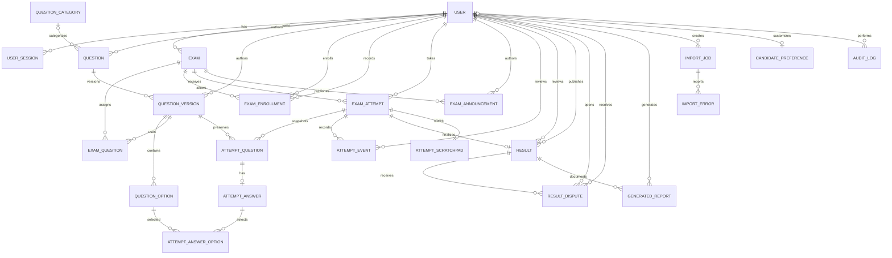

# Database Design

## Scope and Workspace Findings

The existing project is a JavaScript npm-workspace monorepo. The backend uses Express; no Prisma package, schema, existing migration, database client, or real `.env` file was present. The root `.env.example` contained placeholders only and was extended without creating or replacing `.env`.

The schema targets Prisma 7.10.1 and PostgreSQL on Neon. Prisma 7 uses `prisma.config.js` for CLI connection configuration; the JavaScript `prisma-client-js` generator is retained to avoid introducing TypeScript. The schema contains models only: no API, seed script, migration, database connection, or migration execution has been added.

## Entity Relationship Diagram



`AttemptAnswerOption` is the join table for the many-to-many selection between answers and question options. The `ExamAttempt` participant relationship supports both official candidates and examiner sandbox previews; role and mode compatibility is checked by the backend.

## Model-by-Model Design

All IDs are UUIDs. Timestamp columns use PostgreSQL `timestamptz`. Tables use snake_case names while Prisma model and field names remain JavaScript-friendly camelCase.

| Model | Purpose, important fields, and relationships | Key constraints and indexes |
|---|---|---|
| `User` | Account identity, `passwordHash`, fixed `role`, active flag. Parent for sessions and owned/authored records. | Unique email; index role + active state. |
| `UserSession` | Refresh/session record; stores only `tokenHash`, expiry, revocation and last-use times. | Unique token hash; indexes user + expiry and expiry for cleanup. |
| `QuestionCategory` | Reusable topic/category for question-bank records. | Unique name. |
| `Question` | Stable question-bank identity, author, optional category, active flag, version collection. | Index author + active and category. |
| `QuestionVersion` | Immutable question content snapshot: version number, text, difficulty, type, default marks, marking guide and author. | Unique question + version number; indexes question + creation time and difficulty + type. |
| `QuestionOption` | Ordered choice options and protected correct-answer flags for a specific version. Written questions have no options. | Unique version + position; index version + correctness. |
| `Exam` | Owner, title/instructions, availability window, duration, attempt limit, randomization and lifecycle status. Total marks are derived from assigned marks. | Index owner + status and status + availability window. |
| `ExamQuestion` | Many-to-many assignment of a specific question version to an exam, with stable position and assigned marks. | Unique exam + position and exam + version. |
| `ExamEnrollment` | Candidate enrollment and enrollment actor/status. | Unique exam + candidate prevents duplicates; indexes candidate/exam + status. |
| `ExamAttempt` | Official or sandbox run, participant, attempt number, status, server-set start/expiry, duration snapshot and submission time. | Unique exam + participant + mode + attempt number; indexes for exam, participant, status and expiry lookups. |
| `AttemptQuestion` | Per-attempt assignment of a question version, order, assigned marks and ordered option IDs. These values preserve the active attempt's presentation. | Unique attempt + position and attempt + version. |
| `AttemptAnswer` | One autosaved answer per attempt-question: written response, answer state, review flag, awarded marks, grading method and feedback. | Unique attempt-question; index answer/review state and grader. |
| `AttemptAnswerOption` | Join table for selected options; supports one or multiple choices. | Composite primary key answer + option; index option. |
| `ExamAnnouncement` | Examiner-authored messages scoped to an exam, with optional publication time. | Index exam + publication time. |
| `AttemptEvent` | Timestamped network, save-recovery and focus/tab indicators plus JSON metadata and human review status/note. | Index attempt + time, event type + time, review status + time. |
| `Result` | One official result/release record per attempt; total and obtained marks, review/publication status and actors. | Unique attempt; index status + publication time. Obtained marks are a finalized result snapshot. |
| `ResultDispute` | Candidate's explanation and examiner resolution for a result. Candidate identity is derived/authorized through the result's attempt and checked by the backend. | Unique result + opener prevents duplicate disputes; index status + creation time. |
| `GeneratedReport` | Report metadata, storage key, checksum and unguessable verification UUID, tied to a result and generator. File bytes live in object storage, not PostgreSQL. | Unique verification code; index result + generation time. |
| `ImportJob` | Candidate/question import type, source reference, progress counts, lifecycle and creator. | Index creator + creation time and status + creation time. |
| `ImportError` | Row/field-level import error without storing the raw row or credentials. | Index job + row number. |
| `CandidatePreference` | One persistent JSON preference object per user for display-only settings. | User ID is the primary key and one-to-one foreign key. |
| `AttemptScratchpad` | One autosaved scratchpad per attempt. | Unique attempt ID. |
| `AuditLog` | Actor, action, polymorphic entity reference and selected before/after JSON values. Not a foreign-key to every possible target table. | Index actor + time, entity + time, action + time. Keep secrets and answer text out of audit values. |

## Relationship and Design Decisions

- **Roles:** `UserRole` is a PostgreSQL enum (`ADMIN`, `EXAMINER`, `CANDIDATE`). A separate role/permission table is not justified for three fixed roles in this time-limited build; permission checks belong in backend authorization. `Exam.ownerId` limits examiner access to owned exams, while administrators may have global access. Add an exam collaborator model only if shared examiner access becomes a confirmed requirement.
- **Question versioning:** editing a question creates a new `QuestionVersion`; it does not modify an existing version. `ExamQuestion` selects a version, and `AttemptQuestion` stores that version and assigned-mark snapshot directly. Existing attempts also retain their order and option order. The backend should treat versions as append-only; a database trigger/privilege policy can enforce this against direct SQL edits.
- **Answer keys:** correct flags remain in `QuestionOption`, but candidate-facing queries must explicitly omit them. Database relationships alone do not provide field-level authorization.
- **Autosaving and review:** every answer is an independent row with `updatedAt`; marked-for-review is a separate boolean so an answered question can also be marked. Selected objective answers are normalized in `AttemptAnswerOption`.
- **Time and retries:** the backend creates attempts transactionally, stores `expiresAt` using server time and reuses it on reconnect. `maxAttempts` is enforced by backend transaction/locking. Sandbox attempts are excluded from official result creation and analytics.
- **Grading/results:** awarded marks are stored per answer; results hold the official total/obtained snapshot and publication lifecycle. Grade changes and publication should be recorded in `AuditLog` in the same transaction. Analytics are derived from attempts and answers rather than duplicated tables.
- **Secondary features:** events, reports, imports, preferences, scratchpads, announcements and disputes each have a focused model. Event indicators are review signals, not proof of misconduct.
- **Referential actions:** sessions and disposable child records cascade with their parent; authored/exam/result records generally restrict hard deletion. Deactivate accounts instead of deleting users with examination history.

## Important Constraints and Migration Follow-Up

Prisma models provide foreign keys, enums, unique constraints and indexes. Prisma schema syntax does not express all cross-row/business invariants. Before deploying a migration, add/check the appropriate PostgreSQL `CHECK` constraints or triggers for:

- `endsAt > startsAt`, positive duration/attempt limits, positive question marks, and non-negative import counts.
- `0 <= AttemptAnswer.awardedMarks <= AttemptQuestion.assignedMarks` and `Result.obtainedMarks <= Result.totalMarks`.
- Objective question option rules (at least one correct option; exactly one for `SINGLE_CHOICE`; written questions have no choice options).
- Consistency that a selected option belongs to the same question version as its attempt answer.
- Only one active official attempt for a participant/exam. A partial unique index is required; ordinary Prisma `@@unique` cannot express the predicate.
- A `Result` is created only for an official attempt, and status/timestamp combinations are coherent.
- Role compatibility (candidate enrollment/official attempts versus examiner sandbox attempts) and dispute ownership.

Several of these invariants span rows or tables and need transaction-safe backend validation even if triggers are added. Use transactions for attempt creation, autosave, final submission/grading, result publication, and audit writes. Never run schema changes with `db push` against an existing database; use reviewed migration history.

## Neon Configuration and Commands

`.env.example` contains placeholders for a pooled `DATABASE_URL` (application traffic, SSL required) and an unpooled `DIRECT_URL` (Prisma CLI/migrations). `prisma.config.js` uses `DIRECT_URL`; the future Prisma Client runtime should use `DATABASE_URL`. Copy it to `backend/.env` and substitute Neon-issued values; do not commit `.env`. No `.env` was created or modified by this task.

From the repository root, validate/generate with commands that run in the backend workspace (so Prisma can load `backend/.env`):

```sh
npm install
npm run db:validate
npm run db:generate
```

The schema was validated and the client generated with Prisma 7.10.1. The user confirmed their current `DATABASE_URL` is unpooled; for schema validation only, it was supplied as a process-local `DIRECT_URL` override. This does not open a database connection. Configure `DIRECT_URL` in `backend/.env` before normal migration use.

`npm audit` reports three high-severity advisories in Prisma CLI's transitive `effect` dependency. The suggested automatic resolution is a breaking Prisma downgrade; it was not applied. Reassess the CLI dependency when Prisma publishes a compatible patched release.

The initial migration was created and applied to Neon after explicit user approval:

```sh
npm run db:migrate --workspace backend -- --name init
```

It created `backend/prisma/migrations/20261127065622_init/migration.sql`; Prisma reported that the database is now in sync with the schema. Future reviewed migrations can use the development command above; use `prisma migrate deploy` to apply committed migrations in deployment.

## Seed Strategy (Not Implemented)

Create one admin, one examiner, a few candidates, sample categories/questions, and a sample draft exam inside a seed transaction. Read initial account details from local environment or an interactive setup step; hash each password in application code using a suitable password-hashing algorithm (for example Argon2id) before inserting. Never store plaintext, use fixed competition credentials, or commit real secrets. Seed question versions/options and exam assignments consistently. No seed script or dependency was added.
